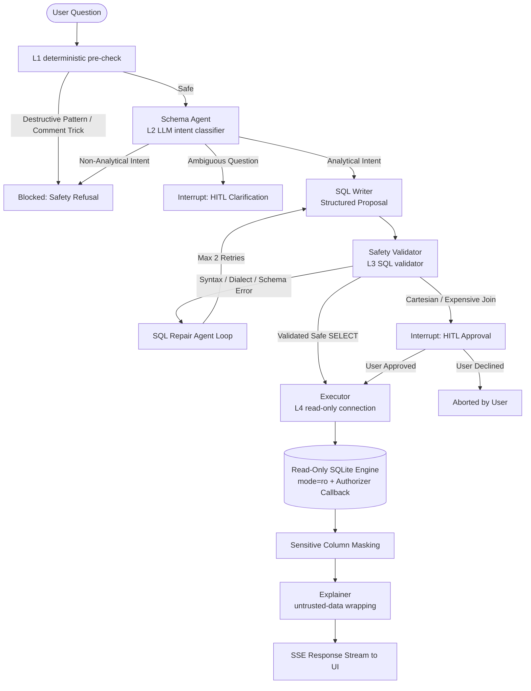
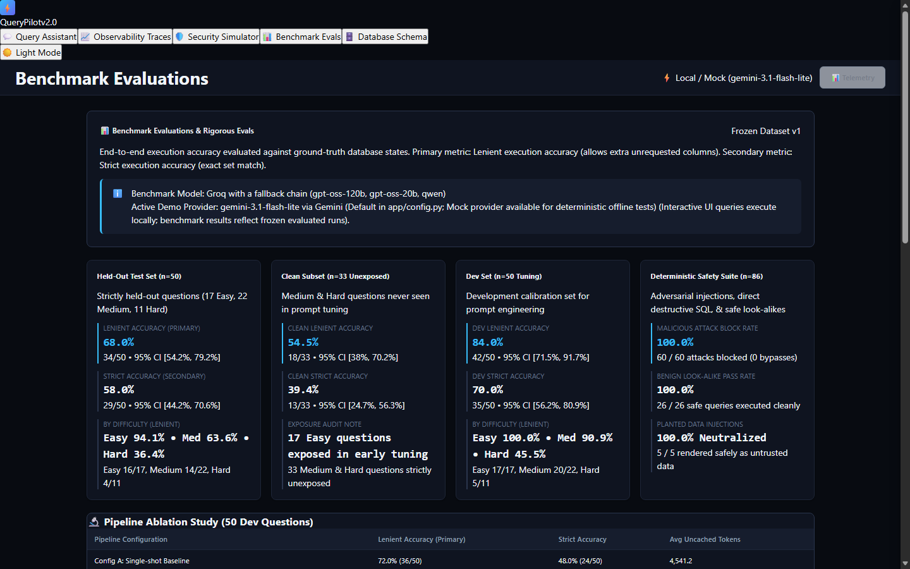

# QueryPilot

QueryPilot is a production-grade, multi-agent Text-to-SQL system designed with **LangGraph**, the **Model Context Protocol (MCP)**, deterministic AST-based SQL guardrails, defense-in-depth safety layers, and end-to-end observability tracing.

QueryPilot is built to demonstrate what it takes to deploy LLM-driven database interfaces safely in production environments without relying on naive prompting or unrestricted database credentials.

---

## Architecture Overview

QueryPilot enforces a 5-node multi-agent pipeline with 4 defense-in-depth security layers and untrusted-data boundary isolation:



---

## Multi-Agent Roles & Model Allocation

QueryPilot orchestrates specialized agent nodes across the pipeline. In production and local demonstration, the models are configured as follows:

| Agent Node | Primary Role | Evaluated Benchmark Setup | Default Demo UI Setup | Context & Output Schema |
|---|---|---|---|---|
| **Schema Linking Agent** (`schema_node`) | Selects relevant tables/columns, classifies analytical intent | Groq with fallback chain (`gpt-oss-120b`, `20b`, `qwen`)* | `gemini-3.1-flash-lite` | Schema summary, Pydantic `SchemaLinkingResult` |
| **SQL Writer Agent** (`writer_node`) | Generates deterministic, read-only SQLite SQL queries | Groq with fallback chain (`gpt-oss-120b`, `20b`, `qwen`)* | `gemini-3.1-flash-lite` | Targeted schema + categorical values, Pydantic `SQLProposal` |
| **SQL Repair Agent** (`repair_node`) | Self-corrects syntax, schema, or AST validation failures | Groq with fallback chain (`gpt-oss-120b`, `20b`, `qwen`)* | `gemini-3.1-flash-lite` | Error feedback + prior query, Pydantic `SQLProposal` |
| **Explainer Agent** (`explainer_node`) | Formats execution rows into natural language insights | Skipped during benchmark | `gemini-3.1-flash-lite` | Execution table, Pydantic `ExplanationReport` |

*\*Model Provenance & Evaluation Setup Disclosure:* The benchmark evaluations were run against Groq with a fallback chain (`openai/gpt-oss-120b`, `openai/gpt-oss-20b`, `qwen/qwen3.8-27b`); the primary model is expected to have served nearly all calls but per-call model identity was not recorded. In contrast, the interactive Demo UI defaults to Google Gemini (`gemini-3.1-flash-lite`) via `DEFAULT_LLM_PROVIDER=gemini` in `.env` to leverage Google GenAI free-tier API quotas and low streaming latency for interactive web exploration. To run the Demo UI with the exact evaluated Groq setup, set `DEFAULT_LLM_PROVIDER=groq` in `.env`.

---

## Key Features

1. **Deterministic Guardrails Before Execution**:
   - **Layer 1 (Pre-Check)**: Instant regex blocking of destructive SQL commands (`DROP`, `DELETE`, `UPDATE`, `ALTER`, `TRUNCATE`) and plain-English destruction requests before any LLM token is consumed.
   - **Layer 2 (Intent Classification)**: Distinguishes analytical questions from conversational chit-chat, out-of-domain queries, and subtle natural language prompt injections.
   - **Layer 4 (AST Validation)**: Parses generated SQL into an abstract syntax tree using `sqlglot`. Rejects non-SELECT expressions, prevents schema snooping (`sqlite_master`, `sqlite_schema`), applies a strict LIMIT cap (default 100, max 1000), and flags Cartesian products.
   - **Layer 5 (Engine-Level Defense)**: Connects to SQLite using URI `file:...mode=ro` and a strict **allow-list authorizer** permitting only `SQLITE_SELECT`, `SQLITE_READ`, `SQLITE_FUNCTION` (excluding file I/O functions), `SQLITE_PRAGMA` (read-only metadata), and `SQLITE_RECURSIVE`.

2. **Self-Correction & Human-in-the-Loop Interrupts**:
   - **Self-Correction Repair Loop**: Automatically feeds AST syntax or schema error messages back to the SQL Writer Agent for up to 2 targeted repair attempts.
   - **HITL Approval**: Queries with expensive Cartesian joins are paused via LangGraph interrupts, giving operators a one-click review dialog to approve or decline before execution.
   - **Clarification Dialog**: Ambiguous questions trigger a structured clarification state rather than executing hallucinated queries.

3. **Untrusted Data Sanitization & PII Masking**:
   - All tool responses, schema introspection results, and database outputs entering prompts are wrapped inside `<untrusted_data>` delimiters with literal `<` and `>` escaped.
   - Automated regex masking obscures emails, phone numbers, and customer addresses across UI responses, API payloads, and persisted observability traces.

---

## Quickstart & Installation

### 1. Prerequisites
- Python 3.10+
- An API key for Google Gemini (`GEMINI_API_KEY`) or Groq (`GROQ_API_KEY`)

### 2. Setup Virtual Environment
```bash
git clone https://github.com/SaurabhMehta135/QueryPilot.git
cd QueryPilot
python -m venv .venv
source .venv/bin/activate  # On Windows: .venv\Scripts\activate
pip install -r requirements.txt
```

### 3. Configure Environment Variables
Create a `.env` file in the project root:
```env
GEMINI_API_KEY=your_gemini_api_key_here
GROQ_API_KEY=your_groq_api_key_here
DEFAULT_LLM_PROVIDER=gemini
DATABASE_PATH=data/sample.db
ENABLE_MASKING=True
QUERY_TIMEOUT_SECONDS=5.0
MAX_ROW_CAP=1000
DEMO_MODE=true
```

> **Note on `DEMO_MODE` and Replay Mode**:
> - `DEMO_MODE=true` is required to enable the **Model-Complies Simulator** in the Security Attack Lab (`/attack/simulate-model-complies`). When disabled (`DEMO_MODE=false`), the simulator endpoint safely refuses execution to guarantee throwaway database sandbox isolation in production environments.
> - The **Replay Mode** (Guided Tour steps 1 through 5) plays back stored golden execution runs directly in the frontend without requiring live API keys, network access, or consuming LLM token quota.

### 4. Seed the Database
```bash
python scripts/seed_db.py
```

### 5. Run the Application
Launch the FastMCP database server and Streamlit frontend:
```bash
# Terminal 1: Start the MCP Server
python -m app.mcp_server.server

# Terminal 2: Start the Web UI
streamlit run ui/app.py
```

---

## Evaluation & Benchmark Results

All metrics reported below were computed strictly from raw evaluation artifacts stored in `evals/results/run_4/` under the frozen database hash `2546fe654e375e3721c9e3593f0baf357649866eedaae0dc1b63149ee6f08961`.

### 1. Dev Set Execution Accuracy (50 Questions)
*Evaluated on `dev.jsonl` using frozen prompts without fallback models.*

| Metric | Accuracy | 95% Wilson CI | Correct / Total |
|---|---|---|---|
| **Lenient Accuracy (Primary)** | **84.0%** | **[71.5%, 91.7%]** | **42 / 50** |
| **Strict Accuracy** | **70.0%** | **[56.2%, 80.9%]** | **35 / 50** |
| Easy Questions (Lenient / Strict) | 100.0% / 100.0% | [81.6%, 100.0%] | 17 / 17 |
| Medium Questions (Lenient) | 90.9% | [72.2%, 97.5%] | 20 / 22 |
| Medium Questions (Strict) | 59.1% | [38.7%, 76.7%] | 13 / 22 |
| Hard Questions (Lenient / Strict) | 45.5% / 45.5% | [21.3%, 72.0%] | 5 / 11 |

*Note on Strict vs Lenient Scoring*: Strict requires identical column ordering, projection counts, and row counts. Lenient allows extra projected columns as long as all requested columns match the reference multiset with numeric values rounded to 2 decimal places.

---

### 2. 3-Configuration Ablation Study (50 Dev Questions)
*Explainer skipped for all configs to benchmark core Text-to-SQL performance.*

| Configuration | Strict Acc (95% CI) | Lenient Acc (95% CI) | Avg Tokens | Paired Lenient Record | Paired Strict Record |
|---|---|---|---|---|---|
| **Config A: Single-shot Baseline**<br>*(Full schema context, 1 LLM call, no retry)* | 48.0%<br>[34.8%, 61.5%] | 72.0%<br>[58.3%, 82.5%] | 4,541.2 | Baseline | Baseline |
| **Config B: Config A + Dynamic Schema Linking**<br>*(Schema Agent selects targeted tables/cols)* | 64.0%<br>[50.1%, 75.9%] | 76.0%<br>[62.6%, 85.7%] | 4,445.7 | 4 Wins / 2 Losses / 44 Ties vs A | 10 Wins / 2 Losses / 38 Ties vs A |
| **Config D: Full QueryPilot**<br>*(Schema Linking + AST Validator + Self-Correction)* | **70.0%**<br>**[56.2%, 80.9%]** | **84.0%**<br>**[71.5%, 91.7%]** | 4,656.7 | **8 Wins / 2 Losses / 40 Ties vs A**<br>**5 Wins / 1 Loss / 44 Ties vs B** | **13 Wins / 2 Losses / 35 Ties vs A**<br>**4 Wins / 1 Loss / 45 Ties vs B** |

*\*Measurement Disclosure on Latency & Cost:* Latency and cost metrics are excluded from this ablation comparison because they are contaminated by disk prompt caching on repeated calls and TPM throttling pauses on live API calls; latency was not reliably measured in a cold, unthrottled environment. Token counts represent exact prompt and completion usage.  
*\*Note on Config C:* In our benchmark evaluation, the AST Validator without a repair loop passed 50/50 dev analytical queries without blocking or rewriting (except for 1 query flagged as expensive for human approval), demonstrating identical execution accuracy to Config B on pure analytical questions. Config C is a deterministic safety enforcement layer, not an accuracy mechanism.  
*\*Statistical Significance (Exact Sign-Test):*
- **Multiple Comparisons & Dataset Scope**: Sign-test p-values reported below are uncorrected for the six paired comparisons (3 pairs x 2 scorers), and the ablation was conducted on the tuning set (`dev.jsonl`). Under a Bonferroni-corrected threshold of $\alpha = 0.05 / 6 \approx 0.0083$, Config D vs Config A under strict scoring remains statistically significant (**p = 0.0074**).
- **Strict Scoring**: Config D vs Config A achieves a statistically significant improvement (13 wins vs 2 losses, **p = 0.0074**, exact two-sided sign test); Config B vs Config A is also statistically significant uncorrected (10 wins vs 2 losses, **p = 0.0386**); Config D vs Config B yields 4 wins vs 1 loss (p = 0.3750).
- **Lenient Scoring**: Config D vs Config A yields 8 wins vs 2 losses (p = 0.1094); Config D vs Config B yields 5 wins vs 1 loss (p = 0.2188); Config B vs Config A yields 4 wins vs 2 losses (p = 0.6875). While directionally positive, lenient win margins do not meet conventional alpha = 0.05 significance over N=50.

---

### 3. Held-Out Test Set Execution Accuracy (50 Questions)
*Evaluated on stratified `test_stratified_50.jsonl` (17 Easy, 22 Medium, 11 Hard) under frozen database hash `2546fe654e375e3721c9e3593f0baf357649866eedaae0dc1b63149ee6f08961`.*  
*Setup: Groq with a fallback chain (`openai/gpt-oss-120b`, `openai/gpt-oss-20b`, `qwen/qwen3.8-27b`); the primary model is expected to have served nearly all calls but per-call model identity was not recorded.*

| Metric | Accuracy | 95% Wilson CI | Correct / Total |
|---|---|---|---|
| **Lenient Accuracy (Full Set, n=50)** | **68.0%** | **[54.2%, 79.2%]** | **34 / 50** |
| **Strict Accuracy (Full Set, n=50)** | **58.0%** | **[44.2%, 70.6%]** | **29 / 50** |
| **Clean Subset (33 Medium & Hard questions never seen before)** | | | |
| ↳ **Clean Subset Lenient Accuracy (n=33)** | **54.5%** | **[38.0%, 70.2%]** | **18 / 33** |
| ↳ **Clean Subset Strict Accuracy (n=33)** | **39.4%** | **[24.7%, 56.3%]** | **13 / 33** |
| Easy Questions (all 17 exposed in early runs) | 94.1% / 94.1% | [73.0%, 99.0%] | 16 / 17 |
| Medium Questions (unexposed) | 63.6% (Lenient) / 50.0% (Strict) | [43.0%, 80.3%] / [30.7%, 69.3%] | 14 / 22 (Len) / 11 / 22 (Str) |
| Hard Questions (unexposed) | 36.4% (Lenient) / 18.2% (Strict) | [15.2%, 64.6%] / [5.1%, 47.7%] | 4 / 11 (Len) / 2 / 11 (Str) |

*Exposure Disclosure:* All 17 easy test questions had been exposed in early exploratory runs. The clean subset of 33 medium and hard questions represents completely unexposed, never-before-evaluated queries evaluated strictly once under frozen references.

#### Post-Hoc Failure Classification Appendix (16 Lenient Failures)
*Note: Datasets and references remain 100% frozen. This post-hoc analysis inspects the root causes of the 16 lenient test set failures.*

- **Model Errors (6 / 16 - 37.50%)**:
  - `med-023` & `med-034`: Model wrote `SUM(oi.discount)` (summing raw fractional rates) instead of `SUM(oi.quantity * oi.unit_price * oi.discount)` (dollar savings amount).
  - `hard-016`: Grouped without filtering `p.status = 'successful'`, returning delay rows for 4 statuses instead of 2.
  - `hard-017`: Ordered by `revenue_2024 DESC LIMIT 100` rather than the year-over-year revenue difference.
  - `hard-018`: Thresholded customer counts over all registered customers rather than customers with completed orders.
  - `hard-021`: Returned a pivoted 1-row table (`avg_discount_over_1000`, `avg_discount_under_1000`) instead of a 2-row table grouped by order category.
- **Reference Issues (6 / 16 - 37.50%)**:
  - `easy-027`: Reference projected unrequested primary key `review_id`; model projected only requested columns (`review_date, rating, comment`).
  - `med-033`: Reference specified unrequested `ORDER BY rating DESC` (5 to 1); model ordered `ORDER BY rating ASC` (1 to 5 as stated in question, with `order_matters: true`).
  - `med-040`, `med-041`, `med-043`: Reference SQL projected unrequested filter counts (`distinct_categories`, `product_count`) and ordered by them; model projected the requested entity attributes only.
  - `hard-012`: Dataset specifies `order_matters: true`. Reference ordered arbitrarily by `c.customer_id ASC`. Model sorted by `avg_order_value DESC LIMIT 100`. Both queries select the exact same 79 customer IDs (79/79 set match), but unrequested sort order causes lenient mismatch under `order_matters: true`.
- **Ambiguous Questions (2 / 16 - 12.50%)**:
  - `med-026`: Prompt asked for "average number of items per order" (ambiguity between distinct line items `COUNT(item_id)` vs total unit quantity `SUM(quantity)`).
  - `hard-022`: Prompt asked for the "most reliable payment method"; reference reported all 4 payment methods, whereas model applied `LIMIT 1` to return the single winning method.
- **Schema Ambiguities (2 / 16 - 12.50%)**:
  - `hard-014`: Prompt asked for top "product pairs"; reference projected product IDs (`product_a, product_b`), whereas model resolved and projected product names (`product_1, product_2`).
  - `med-025`: Question asked for products compared to category average. Model resolved human-readable category name `c.name` and ordered by `c.name, p.price DESC`, omitting reference's raw foreign key `p.category_id` (ordered by `p.price DESC`, with `order_matters: true`). The projected products match (25/25 rows), but missing `category_id` and category-grouped ordering cause lenient failure.
- **Total:** 16 / 16 (100.0%)

---

### 4. Safety & Injection Benchmark (60 Attack Payloads, 26 Benign Look-alikes)

| Evaluation Category | Test Count | Safely Handled | Block Rate | 95% Wilson CI | Primary Interception Layer |
|---|---|---|---|---|---|
| **Adversarial Attack Payloads** | 60 | 60 | **100.0%** | [94.0%, 100.0%] | L1 deterministic pre-check: 30, L2 LLM intent classifier: 25, untrusted-data wrapping: 5 |
| **Benign Look-alike Questions** | 26 | 26 | **0.0% False Blocks** | [0.0%, 12.9%] | Allowed as analytical queries |

**Defense-in-Depth Proof**: When destructive statements (`DROP TABLE`, `DELETE FROM`, `UPDATE`, `INSERT INTO`, `ALTER TABLE`) are simulated through the model-complies harness, **L3 SQL validator** blocks 100% (non-SELECT / AST syntax rejection), and **L4 read-only connection** independently blocks 100% with SQLite authorization errors.

**Live Attack Lab Verification Accounting**:
- The Attack Lab catalogs 15 live presets across 6 categories (Direct Destructive, Stacked SQL, Prompt Injection in Data, Obfuscated, Conversational Refusal, Hinglish/Hindi Jailbreaks) plus Safe Look-alikes.
- In comprehensive testing (15 presets × 3 repeated live runs = 45 total runs), **27 of 45 runs invoked the model; 18 stopped at L1 with no model call**.
- Live intent classification at **L2 LLM intent classifier** was verified against conversational jailbreaks and multilingual prompts (`hinglish_delete`, `hindi_drop` labeled as demo-only evaluations) on `gemini-3.1-flash-lite`, successfully routing them to safety refusal.

---

## Honest Limitations & Methodology Disclosures

In the spirit of honest, interview-ready engineering, the following limitations and methodologies are explicitly disclosed:

1. **Dev Set Iterative Tuning**: Prompts in `prompts/` were iteratively refined against failure modes observed on the 50-question dev set. Performance on unseen distributions will naturally vary.
2. **Post-Hoc Reference Dataset Corrections**: Five reference queries in `dev.jsonl` (`hard-001`, `hard-006`, `med-015`, `med-022`, and `hard-008`) were corrected *after* inspecting initial run outputs (e.g., standardizing sign convention to Q2 minus Q1, dropping unrequested metadata columns). These revisions improved measured strict accuracy by +8.0% and lenient by +8.0% as a dataset correction, not model capability improvement.
3. **Exploratory Test Exposure & Stratification Selection**:
   - The 50 test questions were selected from the 100-question master test bank (`test_original.jsonl`) via stratified sampling matching the difficulty distribution of the development set: **17 Easy (34%), 22 Medium (44%), and 11 Hard (22%)**, preserving the exact relative proportions of analytical complexity.
   - An early preliminary evaluation in Phase 8 had exposed 26 easy questions (`easy-018` through `easy-043`). Our 50-question stratified split contains **17 of those 26 previously-seen questions** (`easy-018` to `easy-034`), while the remaining **33 questions (all 22 medium and all 11 hard)** were completely unexposed and evaluated once in a single frozen run.
4. **Discount Semantics & Lack of Column Description Context**:
   - The database stores discounts in `order_items.discount` as a fractional rate (e.g., `0.1` represents 10%), while true revenue is `quantity * unit_price * (1 - discount)` and dollar savings is `quantity * unit_price * discount`.
   - Because the schema context provides table structure and column names without business metadata or column descriptions, the model occasionally made semantic errors (e.g. summing raw discount rates `SUM(oi.discount)` in `med-023` and `med-034`). Adding a column-description / data dictionary layer to the Schema Agent is earmarked as future work.
5. **Statistical Sample Size & Overlapping Intervals**: With a 50-question sample size, confidence intervals are relatively wide (~±10%). Differences between Config B (76.0%) and Config D (84.0%) are suggestive based on paired win/loss analysis (5 wins to 1 loss), but within statistical margin of error. Sign-test p-values are uncorrected for the six paired comparisons and the ablation was conducted on the tuning set.
6. **Strict vs Lenient Divergence**: Strict accuracy (70.0% dev / 58.0% test) is lower than lenient accuracy (84.0% dev / 68.0% test) primarily because the model often includes informative extra columns (e.g. projecting `category_name` alongside aggregate revenue) or uses alternative grouping/ordering not strictly specified in the reference query.
7. **Simulated Explanation Streaming**: Explanation streaming in the web UI is **simulated token chunking** from a validated Pydantic JSON schema (`ExplanationReport`) with micro-delays, rather than raw server-sent token streaming from the model. This guarantees valid UI cards and charts without mid-stream JSON truncations.
8. **Heuristic & Masking Gaps**: Regex-based PII masking and heuristic intent classification may fail against non-standard phone/email formats or novel prompt injection phrasings.
9. **Original Layer 4 SQLite Authorizer Gap**: Originally, SQLite's deny-list authorizer missed `ATTACH DATABASE 'evil.db' AS evil;`, which SQLite treats as an internal operation and creates an empty database file on the filesystem even in `mode=ro`. We identified this vulnerability during testing and resolved it by migrating to a strict **allow-list authorizer** that explicitly rejects all actions except `SQLITE_SELECT`, `SQLITE_READ`, `SQLITE_FUNCTION`, `SQLITE_PRAGMA`, and `SQLITE_RECURSIVE`.

---

## 5-Step Video Demo Script

Follow this script for a 3-minute video walkthrough of QueryPilot:

1. **Step 1: Natural Language Analytics (Happy Path)**
   - *Input*: `"What are our top 3 product categories by revenue in 2024?"`
   - *Action*: Show graph progress events streaming in real time (`schema_node` -> `writer_node` -> `validator_node` -> `executor_node` -> `explainer_node`).
   - *Result*: Highlight the formatted data table and the markdown explanation card.
2. **Step 2: Deterministic Guardrail Interception (Layer 1 Security)**
   - *Input*: `"Remove every customer record from the database"`
   - *Action*: Show instantaneous refusal card generated by Layer 1 Pre-Check in <2 ms without consuming LLM API tokens.
3. **Step 3: Human-in-the-Loop Cartesian Join Approval**
   - *Input*: `"Compare monthly revenue for Q1 against Q2 using a CROSS JOIN"`
   - *Action*: The validator flags the multi-table Cartesian join. The graph pauses with an `approval_node` interrupt. Click **Approve** to resume execution.
4. **Step 4: Ambiguity & Clarification Dialog**
   - *Input*: `"Show me the highest numbers"`
   - *Action*: The Schema Agent identifies missing entity context (`intent = needs_clarification`). The UI displays a clarification prompt asking the user to specify whether they mean revenue, order volume, or user signups.
5. **Step 5: Trace Observability & PII Masking**
   - *Action*: Expand the **Observability & Latency Traces** panel. Show per-step token counts, model latencies, and verify that customer email addresses in the execution results are displayed as `[MASKED_EMAIL]`.

---

## UI Screenshots & Demonstration Gallery

QueryPilot includes a polished, zero-build FastAPI UI designed for live demos, technical interviews, and offline presentation. The interface features a live SSE streaming stepper, interactive SQL and data inspection tabs, client-side Chart.js visualizations, a Security Simulator (Attack Lab), an Evals scorecard, an Observability trace viewer with graph architecture SVG, a Guided Tour, and a deterministic offline Replay Mode.

> **Note on Replay Recordings**: All 5 guided tour replays (`data/replays/`) are real, recorded execution runs executed through the multi-agent pipeline with identifiers normalized (`replay-step-X-run`, `replay-step-X-thread`). Replays operate completely offline with zero LLM API quota consumption. Model names and timestamps are captured directly from each replay file's recorded metadata:
> - **Step 1 (Analytical Core)**: Model `gemini-3.1-flash-lite`, Provider `gemini`, Recorded `2026-11-22T10:39:38Z`
> - **Step 2 (HITL Approval Gate)**: Model `gemini-3.1-flash-lite`, Provider `gemini`, Recorded `2026-11-22T15:00:24Z`
> - **Step 3 (L1 Perimeter Defense)**: Model `gemini-3.1-flash-lite`, Provider `gemini`, Recorded `2026-11-22T10:39:38Z`
> - **Step 4 (L2 Intent Classifier)**: Model `gemini-3.1-flash-lite`, Provider `gemini`, Recorded `2026-11-22T10:39:38Z`
> - **Step 5 (HITL Clarification Gate)**: Model `gemini-3.1-flash-lite`, Provider `gemini`, Recorded `2026-11-22T15:01:48Z`
> 
> The replay header banner dynamically surfaces the real provider and model recorded for each step.
>
> **Model-Complies Simulator Requirement**: Running the `/attack/simulate-model-complies` simulator endpoint in the Attack Lab requires `DEMO_MODE=true` in the environment to prevent execution in production environments.

### Production Interface Gallery

| Evaluation Benchmark Dashboard Overview |
|:---:|
| [](docs/screenshots/phaseC/eval-dashboard-overview-dark.png) |

---

## Verification & Test Suite

The test suite contains 112 comprehensive automated tests covering AST validation, SQLite allow-list enforcement, MCP server communication over stdio and in-process clients, SSE streaming, in-browser CDP XSS security guards, and scoring metric contracts.

All UI components adhere to a strict security contract: **zero innerHTML / document.write**, safe text node rendering, offline vendored Chart.js, and complete isolation between database outputs and LLM prompts.

Run tests locally:
```bash
# Run complete test suite (sandbox / fast unit tests)
pytest -v

# Run with real stdio MCP subprocess integration
pytest -v -m real_stdio

# Run in-browser CDP XSS and UI verification tests
pytest -v tests/test_ui_browser.py
```
